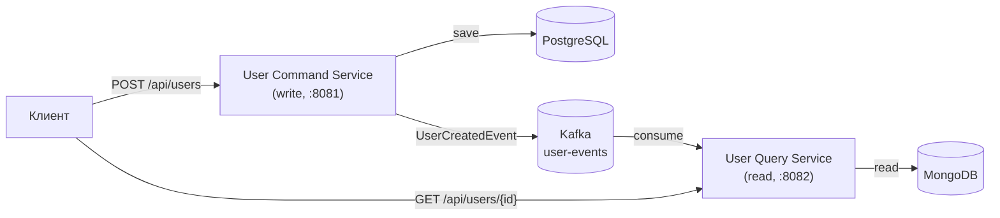

# CQRS — User Service

Проект демонстрирует паттерн **CQRS**: два независимых микросервиса для записи и чтения,
связанных асинхронно через Kafka. Разные хранилища под разные задачи — PostgreSQL для команд,
MongoDB для запросов.

<p align="left">
  
  
  
  
  
  
</p>

## Зачем этот проект

Референсный пример того, как разделить операции записи и чтения на два сервиса с
событийной синхронизацией read-модели. Проект показывает:

- **CQRS** — раздельные command/query сервисы с разными моделями данных;
- **Event-driven синхронизацию** — read-модель обновляется через Kafka (eventual consistency);
- **Polyglot persistence** — PostgreSQL для транзакций записи, MongoDB для документной read-модели;
- **Развязку сервисов** — command-сервис ничего не знает о потребителях своих событий.

## Архитектура



Поток данных: запись идёт в PostgreSQL, событие публикуется в Kafka, query-сервис
обновляет read-модель в MongoDB. Согласованность между сервисами — **eventual**.

### Структура проекта

```
├── user-command-service/     # запись (CREATE)
│   └── ru.kuzmin.usercommandservice/
│       ├── api/              # REST-контроллер
│       ├── command/          # команды и обработчики
│       ├── domain/           # сущность + репозиторий
│       ├── event/            # события
│       └── config/           # Kafka producer
├── user-query-service/       # чтение (GET)
│   └── ru.kuzmin.userqueryservice/
│       ├── api/              # REST-контроллер
│       ├── query/            # запросы и обработчики
│       ├── domain/           # read-модель + репозиторий
│       ├── event/            # Kafka consumer
│       └── config/           # Kafka consumer
└── docker-compose.yml        # PostgreSQL + Kafka + MongoDB + Kafka UI
```

## Технологический стек

| Сервис | Стек |
|--------|------|
| Command (write) | Spring Boot 3.5, Spring Web, Spring Data JPA, Spring Kafka, **PostgreSQL 17** |
| Query (read) | Spring Boot 3.5, Spring Web, Spring Data MongoDB, Spring Kafka, **MongoDB** |
| Инфраструктура | Apache Kafka 3.9 (KRaft), Docker Compose, Kafka UI |

## API

| Сервис | Метод | Эндпоинт | Описание |
|--------|-------|----------|----------|
| Command (:8081) | `POST` | `/api/users` | Создать пользователя, вернуть `id` |
| Query (:8082) | `GET` | `/api/users/{id}` | Получить пользователя по `id` |

```bash
# Создание (command-сервис)
curl -X POST http://localhost:8081/api/users \
  -H "Content-Type: application/json" \
  -d '{"username": "john_doe", "email": "john@example.com"}'
# → "a1b2c3d4-..."

# Чтение (query-сервис), после задержки на eventual consistency
curl http://localhost:8082/api/users/a1b2c3d4-...
```

## Запуск

Требования: Java 21, Maven, Docker.

```bash
docker-compose up -d          # PostgreSQL + Kafka + MongoDB + Kafka UI

# в двух терминалах:
cd user-command-service && mvn spring-boot:run   # :8081
cd user-query-service && mvn spring-boot:run     # :8082
```

Kafka UI — `http://localhost:8888`, события публикуются в топик `user-events`.

## Архитектурные решения (ADR)

Ключевые решения с обоснованием и trade-off'ами — в [`docs/adr/`](docs/adr/README.md):

- [0001 — CQRS: разделение команд и запросов](docs/adr/0001-cqrs-command-query-separation.md)
- [0002 — Синхронизация read-модели через Kafka](docs/adr/0002-event-driven-sync-kafka.md)
- [0003 — Разные хранилища: PostgreSQL + MongoDB](docs/adr/0003-polyglot-persistence-postgres-mongo.md)
- [0004 — Дублирование контракта события между сервисами](docs/adr/0004-event-contract-duplication.md)
- [0005 — Transactional Outbox для надёжной публикации событий](docs/adr/0005-transactional-outbox.md)

## Текущее состояние и Roadmap

| Статус | Пункт |
|--------|-------|
| ✅ | CQRS: два сервиса с раздельными БД |
| ✅ | Event-driven синхронизация через Kafka |
| ✅ | REST API (create + get) |
| ✅ | Docker Compose: PostgreSQL + Kafka + MongoDB + Kafka UI |
| 🔜 | Transactional Outbox (надёжная публикация событий, см. ADR-0005) |
| 🔜 | Валидация + доменные исключения + `@ControllerAdvice` (404/400) |
| 🔜 | Юнит/интеграционные тесты |
| 🔜 | Flyway-миграции (command-сервис) |
| 🔜 | CI (GitHub Actions) |

## Лицензия

[MIT](LICENSE)
